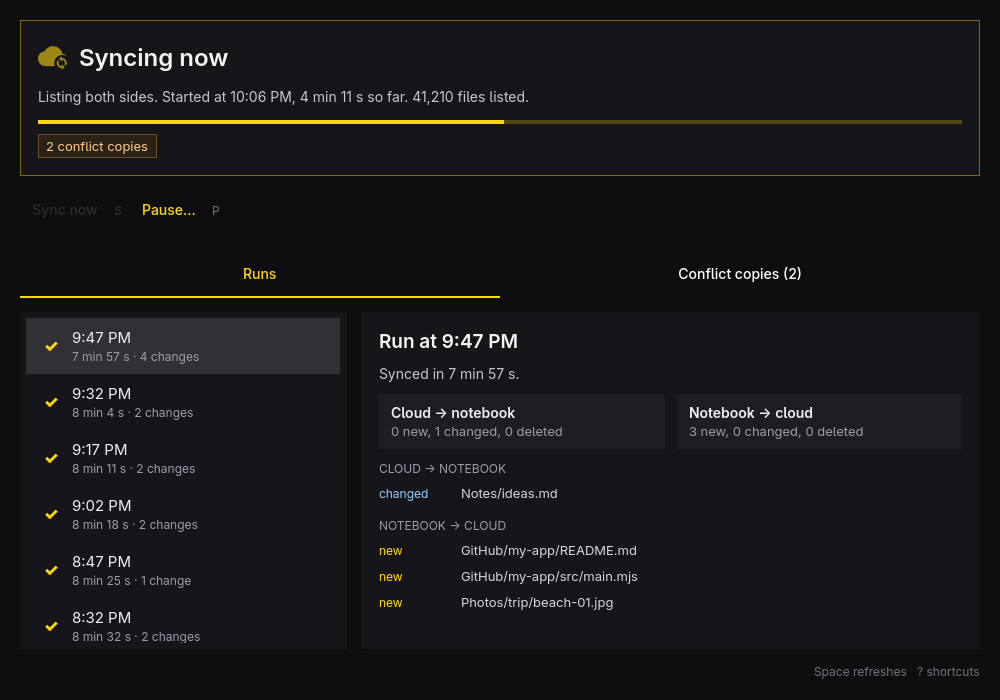
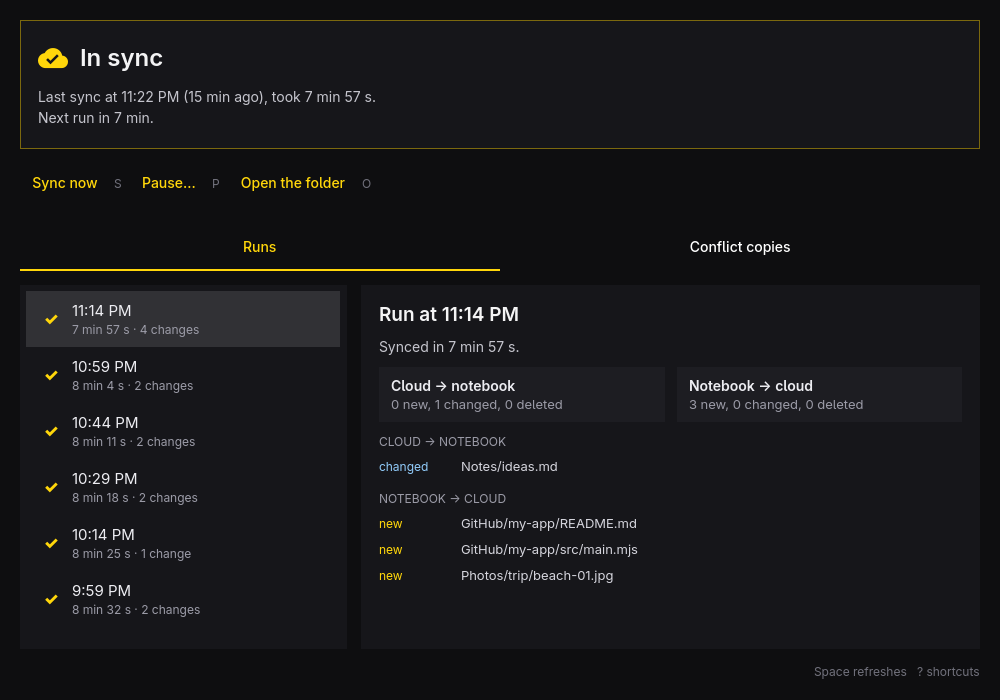
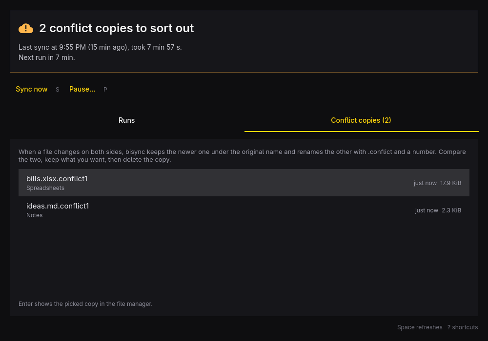
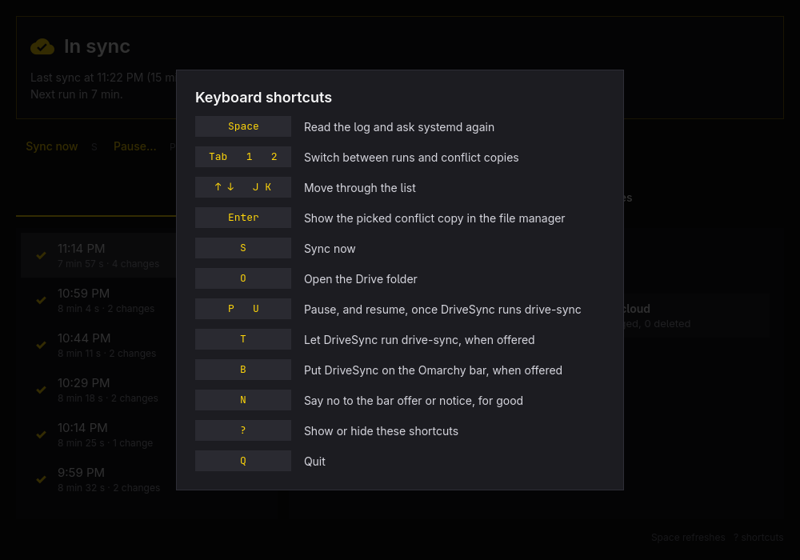
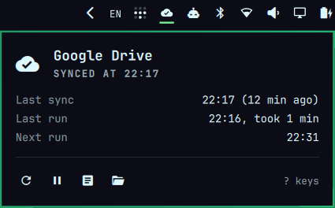
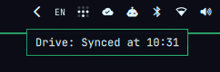

[](https://www.qt.io/) [](https://isocpp.org/) [](https://doc.qt.io/qt-6/qtquick-index.html) [](https://omarchy.org/) [](https://archlinux.org/) [](https://rclone.org/bisync/) [](https://www.google.com/drive/) [](LICENSE)

# ☁️ SyncWatch

SyncWatch is an Omarchy app that shows how `drive-sync` is doing: the rclone
bisync that mirrors `~/Drive` with Google Drive every 15 minutes. One window
and a bar widget, driven from the keyboard.

<p align="center">
  
</p>

- **Status**: in sync, syncing now (with the phase and a progress bar against
  the usual run time), resync in progress, failed (with the same cause the
  desktop notification names and how to recover), cut off, timer off, or no
  sync for a while.
- **Runs**: the last 40 runs from the log, each with what changed in the
  cloud and on the notebook, file by file, and its errors.
- **Conflict copies**: the `*.conflictN` files bisync left in `~/Drive` when a
  file changed on both sides, newest first, one key away from the file manager.
- **Bar widget**: a cloud on the Omarchy bar with the same state as the
  window (a check when in sync, arrows while syncing, a clock while paused,
  an alert on trouble), and a panel with the last sync, the next run and what
  failed.
- **Controls**: sync now; once SyncWatch runs drive-sync, pause for an hour,
  until the next 8:00 or until you resume. A pause survives a reboot.
- **Notifications**: a card when a run fails, a reminder every hour while it
  keeps failing, and a note once it works again; an hourly check for a timer
  that is off; a daily reminder of a pause with no end.
- **Takeover**: runs an existing drive-sync from SyncWatch's own units with
  the same rclone command, so no resync is needed, and can go back.

It never starts a resync and never touches your synced files. It writes its
own state in `~/.local/state/syncwatch/`, the link to its bar widget and,
when you accept, the bar layout through `omarchy plugin`. After a takeover it
also owns `~/.config/syncwatch/` and the `drive-sync` user timers.

## Screens

| Run details                                                                                                         | Conflict copies                                                                                                                   |
| ------------------------------------------------------------------------------------------------------------------- | --------------------------------------------------------------------------------------------------------------------------------- |
|  |  |

> [!NOTE]
> The run details picture is the real app drawn over a made-up log, under
> another Omarchy theme. The other pictures come from a real machine and show
> no file names. No real files or names appear in this repository.

## Shortcuts

| Key              | Action                                            |
| ---------------- | ------------------------------------------------- |
| `Space`          | Read the log and ask systemd again                |
| `Tab`, `1`, `2`  | Switch between runs and conflict copies           |
| `↑` `↓`, `J` `K` | Move through the list                             |
| `Enter`          | Show the picked conflict copy in the file manager |
| `S`              | Sync now                                          |
| `P`              | Pause for 1 hour, until 8:00 or until resumed     |
| `U`              | Resume, and start a run                           |
| `T`              | Let SyncWatch run drive-sync, when offered        |
| `B`              | Put SyncWatch on the Omarchy bar, when offered    |
| `N`              | Say no to that offer; it is not asked again       |
| `?`              | Show or hide the shortcuts                        |
| `Q`              | Quit                                              |

<p align="center">
  
</p>

## What it reads

| Source                                                      | For                                                          |
| ----------------------------------------------------------- | ------------------------------------------------------------ |
| `~/.local/state/drive-sync.log`                             | Runs, changes, errors (the last 3 MB)                        |
| `systemctl --user show drive-sync.service drive-sync.timer` | Running, last result, timer on and enabled                   |
| `systemctl --user list-timers drive-sync.timer`             | Next run                                                     |
| `~/.local/state/drive-sync/pausado`                         | A resync from `drive-sync.sh` that paused the timer          |
| `~/.config/syncwatch/config.json`                           | The rclone command, once SyncWatch runs drive-sync           |
| `~/.local/state/syncwatch/paused.json`                      | A pause, and when it ends                                    |
| `find ~/Drive -name '*.conflict[0-9]*'`                     | Conflict copies (`.git`, `node_modules` and `.venv` skipped) |

The log is watched, systemd is polled every 30 seconds (5 while a run is
going), and conflict copies are looked for again every 2 minutes and after
each run. The count of conflict copies is kept in
`~/.local/state/syncwatch/conflicts.json`, so the bar does not walk `~/Drive`
every few seconds.

## Bar widget

<p align="center">
  
  
</p>

The package installs the widget under `/usr/share/syncwatch/omarchy-plugin`.
Omarchy only loads plugins from `~/.config/omarchy/plugins`, so the first time
the window opens it links the widget there and offers to put it on the bar
(`B`). If an older drive-sync widget is on the bar, SyncWatch offers to take
its place. Nothing changes on the bar without that key or button, and the
bar's layout is only changed through `omarchy plugin`. `N` says no, and the
offer does not come back; delete `~/.local/state/syncwatch/bar-declined` to
be asked again. After a package upgrade, `omarchy restart shell` loads the new
widget. In its panel, `S` syncs now, `P` pauses for an hour or resumes, and
`?` lists every key; hovering an icon says what it does.

## Taking over drive-sync

When the window finds a drive-sync made by `drive-sync.sh`, it offers to run
it from SyncWatch (`T`), showing first what moves. Nothing is offered while a
run is going, after a run that failed, or when the old units have anything
SyncWatch cannot keep: the window names what stops it. When the only thing in
the way is a run, `T` arms the offer, and the dialog opens by itself once the
run ends (`T` again cancels). A run that starts while the dialog is open does
not undo the confirmation: the takeover waits for it and then happens by
itself, and `T` cancels the wait.

- The packaged `drive-sync.service` and `.timer` replace the old ones, and
  `drive-sync-watchdog.timer` replaces `drive-sync-vigia.timer`. A unit in
  `~/.config/systemd/user` wins over a packaged one, so installing the package
  changes nothing until a takeover.
- The same remote, folder, work dir, log and rclone flags go to
  `~/.config/syncwatch/config.json`. The filters move with their `.md5` to
  `~/.config/syncwatch/filters.txt`, byte for byte, so bisync keeps its base.
- The old units, `drive-sync.sh`, `drive-sync-aviso`, the filters and the old
  state move to `~/.local/share/syncwatch/taken-over/<date>/`, with a manifest.
  Nothing is deleted. If any step fails, every step done so far is undone,
  except when an old file cannot move back: then every drive-sync timer is
  left off, the error names the file, and the manifest says where each one is.
- `syncwatch takeover --undo` goes back. Until SyncWatch can resync by itself,
  lost listings are fixed the old way: undo, then `drive-sync.sh resync`.

`syncwatch run` refuses to start rclone when the filters' `.md5` is missing or
stale: a single bisync run in that state throws away its base, and only a
resync brings it back.

## Command line

```sh
syncwatch                  # the window (also: syncwatch open)
syncwatch status           # one line: the status and any warnings
syncwatch status --json    # the same state as JSON, for the bar and scripts
syncwatch sync             # one run now
syncwatch pause [--minutes N | --until-tomorrow]   # no flag: until resumed
syncwatch resume           # end the pause and start a run
syncwatch takeover --check | --apply | --undo
```

`sync`, `pause`, `resume` and `takeover` take `--json` and answer
`{"ok": ..., "error": ...}`. The units call `run-condition`, `run`, `notify`
and `watchdog`.

The JSON is version 2 of a fixed contract: `version`, `now`, `status`,
`tone` (`ok`, `busy`, `warning`, `error`), `causeKind`, `causeDetail`,
`warnings`, `running`, `resync`, `canSyncNow`, `lastSuccess`, `lastRun`
(`start`, `end`, `outcome`), `currentRun` (`start`, `phase`), `nextRun`,
`failingSince`, `typicalSeconds`, `conflicts`, `managed`, `paused` and
`pausedUntil`. Times are Unix seconds, `0` when unknown.

## Install

```sh
bin/install
```

It builds the app, packages it with `makepkg` and installs it with pacman
(asks for the sudo password). SyncWatch then shows up in the Omarchy launcher
(`Super + Space`). makepkg works under `build/`, which drive-sync leaves out
of the Google Drive mirror.

## Develop

```sh
bin/build            # build/syncwatch
build/syncwatch      # run it
bin/test             # Qt Test, offscreen
(cd plugin && node --test tests/*.test.mjs)   # the bar widget's logic
```

Needs `qmake6`, `make`, a C++17 compiler and Qt 6 (base, declarative,
wayland), all part of Omarchy.

## Language

SyncWatch follows the language picked under Omarchy's Setup > Language,
live. It ships English and Brazilian Portuguese (`src/i18n/`).

## License

MIT. The theme watcher, the translator and the project layout follow Omacut
and Monologue by David Heinemeier Hansson.
